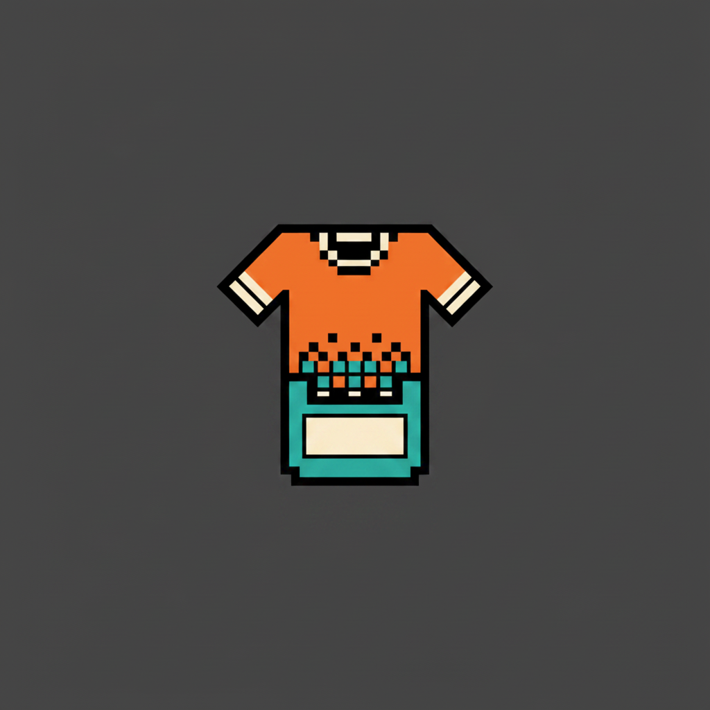

<p align="center">
  
</p>

<h1 align="center">Retro Roster Patcher</h1>

<p align="center">
  Patch real-world sports rosters into retro game ROMs.
</p>

<p align="center">
  <a href="https://github.com/hiitsgabe/retro_roster_patcher/actions/workflows/ci.yml"></a>
  
  
</p>

Retro sports games shipped with the rosters of their release year and no way to change
them. This tool fetches a squad from a live sports API, maps each player onto the attribute
scale the game actually stores, and writes the result into the binary team tables of a ROM
you already own — so a 1994 cartridge lines up with a 2025 season.

| Game | `--game` | Platform | Sport | Providers |
| --- | --- | --- | --- | --- |
| International Superstar Soccer (SNES) | `iss-snes` | `snes` | `soccer` | `espn` |
| Ken Griffey Jr. Presents MLB (SNES) | `kgj-mlb-snes` | `snes` | `baseball` | `espn` |
| MVP Baseball (PSP) | `mvp-psp` | `psp` | `baseball` | `espn` |
| NBA Live 95 (Genesis) | `nbalive95-genesis` | `genesis` | `basketball` | `espn` |
| NHL 2005 (PS2) | `nhl05-ps2` | `ps2` | `hockey` | `espn`, `nhl` |
| NHL 07 (PSP) | `nhl07-psp` | `psp` | `hockey` | `espn`, `nhl` |
| NHL 94 (Genesis) | `nhl94-genesis` | `genesis` | `hockey` | `espn`, `nhl` |
| NHL 94 (SNES) | `nhl94-snes` | `snes` | `hockey` | `espn`, `nhl` |
| PES 2013 (PS2) | `pes2013-ps2` | `ps2` | `soccer` | `espn` |
| Winning Eleven 2002 | `we2002` | `psx` | `soccer` | `espn` |

Every provider is keyless: no credential to supply, and no flag or environment variable for
one. WE2002 also gets its menus translated out of Japanese as part of the same run.

**This project ships no game data.** It patches a ROM or ISO you supply, and never
redistributes one. The tests build synthetic images byte by byte rather than committing a
real dump.

Zero runtime dependencies — the standard library only, so it drops into an embedded or
sandboxed interpreter with no wheel to build. Usable as a library or as a CLI, and the CLI
speaks newline-delimited JSON so another process can drive it. It was extracted from a
pygame launcher for exactly that reason; a Flutter app over embedded CPython is the other
consumer.

## Patch without code: Retro Toolbox

[Retro Toolbox](https://github.com/hiitsgabe/retro_toolbox) is the app for this library, a
graphical way to patch a game with no code and no terminal. Pick the game, the league and
the season, check or edit the teams, choose the screen art, and it writes the patched ROM.
It finds the game file already on your device, works with a gamepad, and runs on Android,
macOS, Windows and Linux handhelds. Get it from its
[releases](https://github.com/hiitsgabe/retro_toolbox/releases) or
[website](https://hiitsgabe.github.io/retro_toolbox/).

## Install

```bash
pip install retro-roster-patcher
```

## Quick start

```bash
retro-roster list
retro-roster analyze --rom nhl94.bin
retro-roster fetch --game nhl94-genesis --provider nhl --season 2025 --out rosters.json
retro-roster patch --game nhl94-genesis --rom nhl94.bin --out nhl94-2025.bin --rosters rosters.json
retro-roster images --game we2002 --rom we2002.bin --out art/
```

`fetch` and `patch` are separate verbs so you can inspect — or hand-edit — `rosters.json`
before anything touches a ROM. `patch --season N` does both in one run instead.

## Command line

Five verbs: `list`, `analyze`, `fetch`, `patch`, `images`. `req` below means the verb refuses
to run without the flag, `yes` means it accepts it, `-` means it does not.

| Flag | `list` | `analyze` | `fetch` | `patch` | `images` | Meaning |
| --- | --- | --- | --- | --- | --- | --- |
| `--help` | yes | yes | yes | yes | yes | usage for that verb |
| `--json` | yes | yes | yes | yes | yes | newline-delimited JSON on stdout instead of human text |
| `--game` | - | yes | req | req | req | patcher id from the table above |
| `--rom` | - | req | - | req | req | input ROM or ISO |
| `--out` | - | - | yes | req | req | where to write the rosters file / the patched ROM |
| `--season` | - | - | req | yes | - | season year, e.g. `2025` |
| `--rosters` | - | - | - | yes | - | patch from a `fetch` file instead of `--season` |
| `--fill-from-other-sources` | - | - | yes | yes | - | soccer: give players the main provider has no head shot for the one FotMob has, matched by birth date and name (a few extra requests per team); FotMob is unofficial, so treat it as best effort. Nothing to add for other sports |
| `--slot-map` | - | - | - | yes | - | JSON list of slot mappings |
| `--language` | - | - | - | yes | - | menu language, for a game that ships translations |
| `--no-logos` | - | - | - | yes | - | draw no team logos: by default `we2002` and `iss-snes` draw each team's logo as its flag and `pes2013-ps2` as its crest, and `nhl94-snes` draws each team's logo on its menus, at center ice and on the title pucks; with this flag a team keeps the striped (`we2002`) or two-band (`iss-snes`) flag, and `pes2013-ps2`, `nhl94-snes` and `kgj-mlb-snes` (which draws each club's logo on team select, Today's Game and the season screens) the cartridge's or disc's logos |
| `--blank-unused` | - | - | - | yes | - | `we2002`, `iss-snes` and `pes2013-ps2`: empty the name and flag (crest) of every slot the slot map leaves out; `iss-snes` blanks its player names too |
| `--image` | - | - | - | yes | - | `SLOT=PNG`, repeatable: replace a screen's art (`we2002`: `title`, `menu`, `boot`; `pes2013-ps2`, `nhl07-psp`, `nhl94-snes` and `kgj-mlb-snes`: see the per-game table) |
| `--provider` | - | - | yes | yes | - | data provider, when the game offers more than one |
| `--league-id` | - | - | yes | yes | - | provider league id |
| `--cache-dir` | - | yes | yes | yes | yes | where caches and generated assets live |
| `--assets-dir` | - | - | yes | yes | - | directory of user-supplied assets, read only |

`--json` and `--help` are accepted on either side of the verb. `analyze` without `--game`
probes every registered patcher and reports the ones that recognise the file. `patch` needs
exactly one of `--season` and `--rosters`; both, or neither, is a usage error.

### What each game requires

| Game | Requires |
| --- | --- |
| `iss-snes` | `--league-id` for `fetch` and for `patch --season` — there is no default league. `--slot-map` for every `patch`: the ROM's 27 slots are national teams and the data is a club league, so there is nothing to match them by. An 8 Mbit (1 048 576-byte) SNES dump, headerless or with the 512-byte copier header. Two different checks, on purpose: `patch` refuses only a file too short to hold the 297 600 bytes this patcher writes, because that one provably cannot be patched, while `analyze` additionally reports `is_valid: false` unless the file clears the 1 MB floor and all 27 entries of each of three pointer tables — selection-screen names, in-game name tiles and team descriptions — dereference to something the writer could use. That second check is a guess about content, so it never blocks a `patch` the user asked for by name. Run on the retail cartridge in Mesen 2: the patched ROM boots, and the team screen shows the new names and eleven. The eleven is the team's most frequent starters over its last few matches on ESPN, placed into the game's 4-4-2 slots (a front three sends its third forward to midfield); places the lineup leaves open go to the season's most frequent starters, so a player with no starts never takes a place from one with starts. Surnames shared within a team are told apart (`G.Silva`, `L.Silva`, or first names). Each player's nine abilities (three speeds, kick power, shooting, technique, stamina, defense, offense) are written where the game reads them, scaled into the ranges the original players use; speed comes from position and age, because ESPN measures no pace. Shirt numbers are unique 1-15 per team. The ability layout was checked in Mesen 2 against the four bars of the pre-match Substituting screen. Each team's crest (its ESPN logo, or `logos/<team_id>.png` under `--assets-dir`) becomes its flag, 24×16 pixels in four colours on white, wherever the game shows a flag: team select, the cup's group table, the league's fixtures, Substituting, the VS banner and the match scoreboard (seen in Mesen 2). At that size fine lines and lettering are lost. All 27 flags share 2 688 bytes; when the crests do not fit, the largest crest that saves bytes by losing a colour loses one, down to two, and only when none can does the largest fall back to the two-band flag in the team's colours. Each of those is reported as a status line, and then the number of crests drawn. A team without a logo gets the two-band flag, and so does every team with `--no-logos`. The flag's first palette entry is also the colour of the team's shirt numbers on both kits (seen in Mesen 2), so it holds a colour that reads on every shade of both shirts: the crest's own when it stands out enough (by brightness first, then red-green hue), else the best of the crest's colours and red, yellow, blue, white, black and grey, with a near tie going to the brighter contrast. A crest without that colour gives up the one it misses least, and the flag's other colours take whichever order of the next three entries compresses smallest. Under budget pressure a crest loses colours one at a time, and only a crest that can lose no more falls back; with real crests nothing falls back, but two-colour crests far from the number colour can, on some kits. A team that keeps the cartridge's flag but gets new kits has that flag redrawn the same way. Eight teams (Holland, England, Denmark, Norway, Ireland, Belgium, Austria, Russia) borrowed a partner's flag on the team-select and table screens; each now has one of its own there, in OBJ tiles those screens leave unused. Every mapped team gets home and away kits in colours and a chest design from its pattern (see Kits). `--blank-unused` empties every slot the slot map leaves out: no name on the team-select screen, in its description or on the in-game name tiles, a transparent flag and blank player names; its kit and abilities stay, and it can still be picked and played (seen in Mesen 2 on team select, the International Cup group table, the World Series fixtures and through a match). |
| `kgj-mlb-snes` | No `--league-id`, and it *refuses* `--slot-map`: it matches each team by its abbreviation. A 2 097 152-byte (16 Mbit) SNES dump, or the same grown to 4 MiB by an earlier patch, headerless or with the 512-byte copier header, and no other size. The team tables are located by searching the image for a 14-byte marker rather than at a fixed offset, which is what makes the header need no arithmetic. `analyze` reports `is_valid: false` when that marker is missing, and also when it matches within 25 280 bytes of the end of the file, because the 28 team blocks would then run off the end and every write would be silently dropped. Each club's 25 records are its lineup, the bench, five starters and five relievers. The lineup is the regulars, by season starts with each start in the club's last ten games counting as ten more (a catcher, a first baseman, three infielders, three outfielders, a batter ESPN lists at DH competing for the outfield, and the next-most-used non-catcher as DH; an NL club bats eight, sitting the weakest bat by OPS of the first baseman, outfielders and DH, and its pitcher ninth), in the order ESPN's last ten games batted them, which is also the order `suggest_squad_order` gives the editor. Ratings come from each player's full ESPN season line (one request a player, cached) on the cartridge's own scales: BAT from AVG, POW from isolated power, SPD from steals and triples, SPD, CON and FAT from K/9, BB/9 and innings per game (starters FAT 5-10, relievers 2-5, so nobody tires after seven pitches); a rating whose stat is missing, or rests on under 100 plate appearances or 20 innings, takes its position default alone. The cards show the real AVG, HR, RBI, W-L, ERA and saves, and both the batting and the throwing hand are written. A bench short of position players takes spare pitchers as IF with the game's own pitcher batting (2/1/3/3). Names: accents become plain letters, apostrophes go, hyphens stay (on the cards and the derby list; the at-bat label's font draws the hyphen as a period, P.CROW.ARM). Each player has his own look on the Line Up and Bullpen cards and in play, where the cartridge's one look used to go on everyone: his skin tone from his ESPN head shot (the face's ITA, cut into the game's six tones; about one face in eight comes out a tone off, mostly between the middle tones), his build from his height and weight (small, average, tall or big at the plate; average, heavy or tall on the mound), and his head, hair colour, stance, arms, bat colour, at-bat animation and delivery a stable pick from his ESPN id among only the values the cartridge's own 700 players use (one past them glitches or hangs the game), hair and facial hair following the skin tone as the cartridge pairs them; a teammate whose card would look like another's is picked again. A player without a head shot, or every player without the `images` extra (said in a status line), gets a skin tone weighted like the league's faces. Head shots are about 185 KB each, so a whole league's first patch downloads about 130 MB into the cache. With Seattle or Tampa Bay patched, a #24 on the Mariners or in the AL All-Stars' place no longer gets Griffey's own head and blonde hair (one byte, the jersey compared at $85:D1C7). `patch(looks=False)` keeps each slot's cartridge look (library API only; the CLI has no flag for it). The Home Run Derby's six batters, their cards and the names on its Select Player screen, become each league's three home-run leaders among the patched players (its two pitchers stay). A save made after Team Edit keeps its names for the edited teams, and an all-zero save blanks every name on any KGJ cartridge. Each club plays as today's: its city and nickname (team select, the standings, the season news), its full name on Today's Game (the nickname alone when both run past the 18 characters the screen shows, so DODGERS, GIANTS, PHILLIES, NATIONALS, GUARDIANS, ATHLETICS), its ESPN abbreviation on the scoreboard, and the Athletics' city is SACRAMENTO, where they play from 2025 to 2027 (ESPN gives none). Houston takes Milwaukee's AL slot and Milwaukee Houston's NL slot, so both bat by their league's rule and sit on its team-select page and in its standings; the slot keeps its 1994 ballpark. Each team-select page is in alphabetical order, ST LOUIS read as SAINT LOUIS as the cartridge sorts it (the logo moves with the team), and the three-division standings show today's divisions (the 1993 two-division format is left as it was). Uniforms take the club's ESPN colours over the cartridge's design for the slot: the cap, and every part of the batter the cartridge draws in the cap's colour, in the club's colour; the parts it draws in a second colour (stripes, often the bill, piping) in the alternate colour, or in the club's colour when the alternate is too light to show on a white or grey jersey; the jersey's and pants' whites and greys stay, and a black cap keeps the cartridge's ramp of dark greys. The fielders' cap and sleeves take the club's colour, their trim the alternate, and a jersey the cartridge draws in the cap's colour (the All-Stars', Chicago's black home) the club's colour; the fielders' colours also dress the pitcher on the mound and on the Bullpen cards. Each club's logo, its ESPN one or `logos/<team_id>.png` under `--assets-dir`, is fitted into the game's 40x40, drawn with the other 29 (the All-Stars' included) through one 15-colour palette the patch computes, which costs busy logos some detail (needs the `images` extra), and the season schedule draws them in it too; a patched ROM patched again with the same logos comes out the same, the All-Stars' logos being drawn from the cartridge's own each time; `--no-logos` keeps the cartridge's. Logos and uniforms are stored in the image grown to 4 MiB and the game's archive pointed at them. Arizona and Tampa Bay, who did not exist in 1994, take the two All-Star teams (`ARI` or `AZ` the National League's, `TB` the American League's, so `analyze` lists 30 slots): the All-Star menu's ALL-STAR GAME option reads ARIZONA-TAMPA and plays Tampa Bay against Arizona with their own 25 players (written to blocks of their own in the image grown to 4 MiB, which the game's player reader is pointed at), lineups of nine with a DH (the game always holds it in Baltimore's park, with the DH), the bench, rotation and bullpen, and their names, abbreviations, logos and home uniforms, which they also wear on the road (the cartridge has no road uniform for these two teams); a season's All-Star break plays them too. They have no place in Single Game, Season or World Series: the team-select grid's 28 logos fill the 1 024 tiles a background can address and its menus have no free cell, and the schedules, standings and division tables hold 28 teams. The Home Run Derby, under the same menu, still pits each league's three home-run leaders against each other (patched clubs, Arizona and Tampa Bay included), but its Select Player cards and batters show the two teams' logos and uniforms, which the derby takes from the same team numbers. Without either club in the rosters its All-Star team stays as the cartridge has it, and `patch(all_stars=True)` keeps both (library API only; the CLI has no flag for it); a ROM patched with them keeps them on a later patch without them. Checked in Mesen 2 on both team-select pages, Today's Game, a game (scoreboard, batter and fielders), the season standings and schedule, and the All-Star screens; Arizona and Tampa Bay on the All-Star menu, team select, Today's Game, every Line Up and Bullpen card of both, a game played computer against computer into the fifth inning, and the Home Run Derby (a season's All-Star break was not reached). Screen art slots `title` (the stadium behind the intro swing, the title, every front-end menu and, dimmed, the season and World Series result screen: 30 colours, 256 tiles; the game's logo, PUSH START, Ken Griffey Jr., the menu boxes, the result text and the copyright stay over it) and `boot` (the Nintendo screen at power-on: 90 colours, 848 tiles; the 176 tiles the credits after it and the hidden credits draw from stay). `images` exports PNGs; `--image` stores the pictures in the image grown to 4 MiB and points the game's archive at them, the cartridge's own left where they are, so a patched ROM can be patched again; an image whose art entries are neither the cartridge's nor a patch's is refused. Checked in Mesen 2 with photos at those budgets on the boot and title screens, the intro, every menu, the hidden credits, team select, Today's Game and a game, and, reached only by jumping to them, on the result screen and on a screen ($85:C4E2) that shows the game's logo over the stadium, probably before a game. |
| `mvp-psp` | No `--league-id`, and it *refuses* `--slot-map`: it matches each team by its abbreviation. An **uncompressed** ISO 9660 disc image, and at least 686 122 913 bytes — `database.big` sits at a fixed sector 334 832 and runs for 386 977 bytes, so a shorter file does not contain the data at all. Two different checks, on purpose: `patch` refuses only a file that fails that arithmetic, because it provably cannot be patched, while `analyze` additionally reports `is_valid: false` unless the compressed section headers are where this game puts them *and* the disc's own `team` table carries at least one of MVP Baseball's 30 team ids. That second check is a guess about content, so it never blocks a `patch` the user asked for by name. A patch can still fail late, and loudly: each of the 19 database sections has a fixed allocation with no length word, so if a rebuilt table compresses larger than the one it replaces the run raises rather than silently keeping the original. Neither check has been run against a real disc. |
| `nbalive95-genesis` | No `--league-id`, and it *refuses* `--slot-map`: it matches each team by its abbreviation. A 2 MB (2 097 152-byte) Genesis dump. `analyze` reports `is_valid: false` unless all 360 player pointers resolve, which rules out every file shorter than 2 064 604 bytes — the ported reader's own 1 572 864-byte floor accepts those and then silently patches nothing for the last twelve teams. |
| `nhl05-ps2` | No `--league-id`, and it *refuses* `--slot-map`: it matches each team by its abbreviation. An **uncompressed** ISO 9660 disc image. Two different checks, on purpose: `patch` refuses a file whose ISO 9660 directory places `DB.VIV` past the end of it, because a truncated archive silently decompresses short and would be written back to the disc corrupted, while `analyze` additionally reports `is_valid: false` unless `DB.VIV` is a BIGF archive holding an `nhl2005.tdb` that decompresses to a TDB. That second check is a guess about content, so it never blocks a `patch` the user asked for by name — `patch` reaches the same fact with a better message, naming the archive's actual file list. Patches the 30 NHL club slots; the two All-Star sides are left alone, so Seattle and Vegas are dropped rather than given a slot. Neither check has been run against a real disc. |
| `nhl07-psp` | No `--league-id`, and it *refuses* `--slot-map`: it matches each team by its abbreviation. An **uncompressed** ISO 9660 disc image — a `.cso`, `.zso`, `.jso` or `.dax` is refused by name, with a message saying to decompress it, rather than reported as the wrong game. Two different checks, on purpose: `patch` refuses a file whose ISO 9660 directory places `db.viv` past the end of it, because a truncated archive silently decompresses short and would be written back to the disc corrupted, while `analyze` additionally reports `is_valid: false` unless `db.viv` is a BIGF archive holding an `nhlbioatt.tdb` that decompresses to a TDB. That second check is a guess about content, so it never blocks a `patch` the user asked for by name. Checked on a real disc (`ULUS10131`) and played in PPSSPP: ratings go in on the game's own 0-49 scale (shown as 50-99), weight as pounds above 150 and height as inches above 54. `db.viv` is written in place, or rebuilt compactly when a table outgrows its slot, and the game's cached copy of its directory (`db.bh` in `PRELOAD/FAPT.VIV`) is rewritten to match. Each written player's portrait in `FE/PORTAPT.VIV` gets the provider's head shot (NHL API or ESPN), or the game's own silhouette when there is none (needs the `images` extra; `patch(portraits=False)` keeps the disc's). Screen art slots `boot`, `title`, `menu`, `logo`, `player`, `loading`, `league_badge`, `players_badge` (`images` exports PNGs, `--image` writes every copy of a slot in place, with fewer colours when it would not fit). `patch(texts={id: text})` replaces front-end strings by id; none by default, so EA's copyright notice on the title stays as the disc has it (its field holds only those two lines). Known gaps: the All-Star slots (Seattle, Vegas) share bio records with NHL players, and salaries and career stats stay the previous player's. Each written player's `SKIN` (the shade the game draws him in, 1-7 on the disc) comes from his head shot through the same measure the other games use, the lightest shade without one; `patch(looks=False)` writes the lightest for everyone (library API only). |
| `nhl94-genesis` | No `--league-id`. It *refuses* `--slot-map`: it matches each team by its three-letter code. |
| `nhl94-snes` | No `--league-id`, and it *refuses* `--slot-map` for the same reason as its Genesis sibling. An 8 Mbit (1 048 576-byte) dump, headerless or with the 512-byte copier header. `analyze` reports `is_valid: false` for a file whose 28 team blocks it cannot find, which includes every file too short to hold the pointer table 927 207 bytes in. Each slot holds two goalies and as many forwards and defencemen as the cartridge's slot (up to its counts), and its header counts what was filled; a re-patch offers the cartridge's counts again, however short an earlier patch left a slot. A team with fewer than two goalies is skipped with a status line and its slot keeps the cartridge's team. The starting goalie is the one who played most (games on the NHL API, wins on ESPN), then the better save %; a goalie on none of ESPN's wins lists counts as one game, so the backups rank and rate by their own numbers. Goalies are written in the game's own goalie fields: agility and the four save zones from save %, awareness from goals-against, both pulled toward an average goalie by ten games' worth so a backup's one perfect night does not rate him a star, and puck control between the two, so a starter rates about 40 to 100 like the cartridge's. A skater missing from one of ESPN's top-25 leader lists takes that list's lowest value, and a stat no list has keeps his position's default. Names are folded to ASCII and kept whole up to the 19 characters the game shows: the 28 team blocks are rebuilt in bank $9C, with the padding that ends the bank (every one of the game's team readers is fixed to that bank, so the blocks cannot move into the grown image), and only if that ran out would the longest names lose their first names to an initial. Each patched team's header also gets the nibbles the game simulates the night's other scores from (attack from goals for, leakiness from goals against, ranked against every club fetched: ESPN's standings, the whole league, or the NHL API's club stats; when there are none a status line says the cartridge's are kept), its 1993 power-play and home-ice bonuses set to 0, and the team overall Matchups shows recomputed from the written Best line. `patch` also fixes the cartridge's hot/cold bug, two bytes at $9F:D23A and $9F:D23E: a player having a cold night had each lowered attribute maxed at 15 instead; `patch(hot_cold_fix=False)` keeps the retail behaviour (library API only; the CLI has no flag for it). Each mapped team plays as today's club, grown into a 2 MiB image: its city, nickname, arena (Ron Barr's welcome) and ESPN abbreviation (the in-game score) in its team block, its city on the coloured banners, banners and uniforms in its ESPN colours (home white with stripes in the team's colours, away in its colour), and its ESPN logo, or `logos/<team_id>.png` under `--assets-dir`, on Game Setup, Player Select, Matchups and the pause screens (48x32, 15 colours), at center ice and on the title-screen pucks (in the rink's colours, its white left to the ice; logos need the `images` extra); `--no-logos` keeps the cartridge's logos. Arenas come from a table in the library, since ESPN's are wrong for some clubs. Seattle and Vegas take the two All-Star slots, which play exhibition games only, and the 32 playoff brackets are rebuilt with today's conferences (Colorado in the West, Detroit and Toronto in the East). A slot no team is mapped to keeps its 1994 identity, and an image without the cartridge's tables keeps every team's. Screen art slots `boot` (the EA SPORTS screen, held still: 159 colours, 255 tiles, none flipped), `title` (the whole title screen under the credits and the two shields: 8 palette rows of 15 colours, 318 tiles; its zooming shields and pucks go) and `menu` (the wallpaper behind Game Setup, Player Select, Matchups, the playoff, shootout and password screens and every pause screen: 15 colours, 355 tiles; the game copies the top-left 56x56 logo box over the top-right one, the old blue wallpaper drawn into Ron Barr's outline on Matchups takes the picture's colours, and the playoff bracket keeps the cartridge's wallpaper). `images` exports PNGs; `--image` writes the pictures into the image grown to 2 MiB and points the game's loads at them, the cartridge's streams left where they are, so a patched ROM can be patched again. Each written player's portrait (Game Setup, Matchups, Edit Lines) gets the provider's head shot, in the 544 KiB of the image grown to 2 MiB that team identity and screen art leave: room for about 850, so every player on today's rosters gets his face (632 of 638 on ESPN's 2026-27 rosters; the other 6 have no photo), and were it ever full the faces go first to every team's Best line (the six Game Setup and Matchups show), then to each team's next player in turn; a player without a head shot (the NHL API's grey silhouette counts as none) gets the game's own drawing of a skater or a goalie, so no 1993 face stays on a new player (head shots need the `images` extra; `patch(portraits=False)` keeps the cartridge's, sending only an earlier patch's faces back to the drawing). Faces and drawings are drawn in the slot's portrait palette: the cartridge's skin tones, and for a mapped team a jersey in its uniforms' colours (white, its colour, its alternate), Seattle and Vegas each on their own instead of the All-Stars' shared one. A re-patch redraws the faces of the teams it maps; the teams it leaves out get drawings. Checked in Mesen 2 on all those screens, the attract mode and a match. |
| `pes2013-ps2` | `--league-id` for `fetch` and for `patch --season` — there is no default league. `--slot-map` for every `patch`: the 139 club slots are named after the game's own clubs (licensed or not), and `analyze` lists them so a league can be laid over any of them. An **uncompressed** ISO 9660 disc image of the US release (`SLUS_219.55`); `analyze` reports `is_valid: false` unless the boot file, `0_TEXT.AFS` and `OVER.AFS` are all in the root directory. A patched club gets its name and three-letter code in every language overlay, its ESPN logo, or `assets_dir/logos/<team_id>.png` when the patcher was built with an `assets_dir`, drawn as its crest (64x64 and 32x32 atlases, each drawn through one palette shared with the flags, so the flags are redrawn through the new palette too; `--no-logos` keeps the originals), and the names and shirt numbers of the players its squad already points at: the eleven who started most of the team's last five matches on ESPN come first, each taking the lineup place whose record holds the position he started in (the first eleven places are the club's formation), then the bench by position group, and the record's abilities are left as they were. The display name is the full name when it fits 15 characters, the shirt name the surname, as on the disc. The league itself is renamed and gets its ESPN logo on the team-select screen for every slot group (England 0-19, France 20-39, Italy 40-59, Netherlands 60-77, Spain 78-97) that received a team (the names are found relative to the untouched "Ligue 1" string, so patch an original disc, not a patched one). National teams are slots `1000` and up (`analyze` lists the 67 named ones; `national_slot_map` pairs them with league 2021, international friendlies, by code then name); a national squad only takes over records no club squad shares, so it may fill fewer than 23 places. Several leagues go in at once by merging their `MappedRosters` (`a.merge(b)`). `--blank-unused` empties the name, code and crest of every club the mapping left out, the name and icon of every league group without a team, and the name of every national team left out (clubs only when clubs were mapped, nationals only when nationals were). Kits: every mapped club and national team gets home and away kits drawn from colours (`retro_roster_patcher.core.kits.KitSpec`: shirt, secondary, pattern, shorts, socks, sleeves), by default plain kits in the provider's two team colours; `patch(kits={slot: {"home": spec, "away": spec}})` overrides a slot, a spec being a `KitSpec`, its dict or `{"image": png}` (a picture of the kit, read for its colours and pattern by `kit_from_image`; a 512x256 picture for a team with a licensed kit is instead painted into that kit's texture package, re-encrypted, and the kit stays licensed; `{"template": n}` is refused, the disc has no jersey designs to pick from), and `kits=False` keeps the disc's. The disc's shirt template draws vertical stripes and contrasting sleeves, so `stripes`, `pinstripes` and `hoops` become stripes and `halves`, `sash` and `chevron` plain shirts with contrasting sleeves; a kit so written is parametric, drawn from the colours even for a club whose shirt was a licensed texture. Club slots 130 and up have no kit record. Screen art slots `title`, `menu`, `loading`, `match` are UI textures (`images` exports PNGs, `--image` writes them with their own 256-colour palette). A rebuilt entry may run into the sector padding after it but never changes its size field, because the game hangs at boot when an entry's size changes — checked on a real disc in PCSX2. Real names compress worse than the disc's, so when the player entries outgrow that room the records no squad points at are blanked (names and abilities) and the national squads take fewer of them. Each written player's skin colour (byte 115 bits 0-2, the editor's 1-6) comes from his head shot: the six colours the disc draws, ordered by the lightness PCSX2 shows, the East Asian one by nationality; and, as the game itself does when a player is edited, the licensed face is turned off so the generic face takes the colour (a licensed face keeps its own colour otherwise). Without a usable photo the palest; `patch(looks=False)` gives everyone the palest (library API only). Hair colour and beard are in the record but not yet decoded, so the record's own stay. |
| `we2002` | `--league-id` for `fetch` and for `patch --season` — there is no default league, and without one both fail with `CapabilityError` before any request goes out. Patch an original disc: the community English translation writes absolute offsets, so on another dump or a disc patched before (its screen files were rebuilt) it would corrupt the menu art; the patcher notices (the screen files no longer parse), restores the output from the input and reports the translation as skipped. `--slot-map` for every `patch`: the ROM's team slots are unnamed, so there is nothing to match teams against. Each team gets 23 players (a national slot holds them all, a Master League slot the first 14 or 15): the eleven who started most of the team's last five matches on ESPN take the first 11 places, the game's 4-4-2, filled back to front by the positions they started in, so a line with one player too many hands its most advanced one to the next line up (a back five's wing-back plays midfield, a front three's winger midfield) and a line one short takes the deepest of the next (a back three takes a wing-back); a second keeper sits. Places the lineup leaves open, or every place when ESPN has no lineup, go to the season's most frequent starters. The bench takes a keeper and one player from each line in turn, up to 2 keepers, 3 defenders, 2 midfielders and 4 forwards, so the 14 or 15 a Master League slot keeps have a sub for every line however the eleven was coded; the best of the rest take the last place. A player keeps his ESPN position (the byte the game shows) in whatever line the 4-4-2 puts him: the patcher writes no formation, so each slot plays the disc's own. Kits: every mapped team gets home and away kits drawn from colours (`retro_roster_patcher.core.kits.KitSpec`: shirt, secondary, pattern, shorts, socks, sleeves), by default plain kits in the provider's two team colours, painted into the team's 3D kit texture (`TEX_nn.BIN`) and its 2D team-select preview; `patch(kits={slot: {"home": kit, "away": kit}})` overrides a slot, a kit being a `KitSpec`, its dict, `{"image": png}` (the picture itself is mapped onto the texture: chest, sleeves, shorts, socks) or `{"template": n}` (one of the disc's 95 jersey designs, which `kit_templates` lists with a preview of each), and `kits=False` leaves the textures and previews as the disc has them. A spec or picture is painted over a plain white template (Classic England, or the design named) so the texture keeps its folds and seams: `stripes` are 4 px bands running on across the front, sides and sleeves, `pinstripes` a 1 px line every 4, `hoops` 4 px bands down each piece, `halves` the right half of the front with the right sleeve and side, `sash` a diagonal band across the front, `chevron` a V across the chest and `sleeves` contrasting sleeves; the collar always takes the contrast colour, the goalkeeper's half of the page and the number font keep their colours, and a file is held under the 36 864 bytes the game loads of it. Needs Pillow; without it a slot takes the whole texture of the team whose shirt colour is nearest, as before. Each player's look comes from his head shot (needs the `images` extra): his skin tone from the face (the four tones the disc draws, the East Asian one by nationality since the disc gives it to Japan, Korea and China alone), his hair colour from the hair above it (black, brown, grey or blond as the disc draws them; a redhead is brown), a shaved head the closest crop, his height and build from the provider's height, his age from the provider, and his hair style and beard a stable pick weighted like the disc's players of his tone; a player without a usable photo gets the plainest look, pale with black hair and no beard, never the disc's. `patch(looks=False)` skips the head shots and gives everyone that plain look (library API only). Checked in DuckStation: 容姿設定 cycled through every value, and a Brasileirão line-up at the team photo. |

League ids are the provider's own. ESPN's soccer ids run from 2001 (Premier League) through
2016, in `sports.espn.ESPN_LEAGUES`. An id the chosen provider does not know is reported as
`ApiError: League N not found`.

A slot map is a JSON array of `{"slot_index", "team_id", "team_name"}` objects, which is
what `SlotMapping.to_dict()` produces:

```python
import json
from pathlib import Path

from retro_roster_patcher import SlotMapping

mappings = [
    SlotMapping(slot_index=0, team_id=359, team_name="Arsenal"),
    SlotMapping(slot_index=1, team_id=364, team_name="Liverpool"),
]
Path("slot-map.json").write_text(json.dumps([m.to_dict() for m in mappings], indent=2))
```

### Translations and user assets

`--language` is honoured by games that ship translations — `we2002` takes `en`, `es`, `fr`
and `pt` — and is a usage error on a game that does not, rather than a flag silently
dropped.

`--assets-dir` is a directory the tool only ever reads. Its one use today is the community
WE2002 menu translation `w202-english.ppf`, which this project does not redistribute: drop
that file in and its menu records are merged into whichever language PPF `--language`
selected. Without it the roster patch still applies and the menus stay Japanese.

### Team logos

`we2002` draws every mapped team's logo where the game draws its flag: the
team-select grid, the small flag beside the selected team, and the large flag of
the match intro and scoreboard. The logo is the one the provider publishes for
the team (ESPN's `Team.logo_url`), downloaded once into `--cache-dir` and
rendered with Pillow, so this needs the `images` extra:

```bash
pip install "retro-roster-patcher[images]"
```

Without Pillow the roster patch still applies and the flags stay the striped
default, with one status line saying so. `--no-logos` turns the logos off on
purpose. `--blank-unused` deals with the slots a league does not fill: every
national and Master League slot outside the slot map gets an empty name, a
black kit and a fully transparent flag, so the menus show the mapped teams and
blank entries rather than the 2002 squads. To use your own image for a team, put a PNG at
`<assets-dir>/logos/<team_id>.png` (ESPN's team id, the one in the slot map)
and pass `--assets-dir`; it wins over the download.

How it works, and the limits that follow. A WE2002 flag is a *style* byte per
team (one of 61 shapes drawn as 4bpp bitmaps) plus a 16-colour palette per
team, so each logo needs a style of its own: the patcher picks styles no
untouched team uses first, then the least-used ones, and 53 styles exist, so a
league of more than 53 teams leaves the rest striped. Fifteen opaque colours
and a transparent background is what a style holds, which is what the logo is
reduced to: fourteen of its own colours plus white, because the copies of the
atlas in the stadium files (the sideline and crowd flags a match draws) get
the logo on a white ground, where the menu copies keep it on transparency.
Master League slot 22 draws through slot 10's palette and keeps the striped
flag. The bitmaps live LZSS-compressed in the team select, match HUD, editor
and stadium data files; those are re-encoded, and one that no longer fits
grows into the free sectors after it, with the executable's own file table
raised to match. The rewritten sectors carry fresh EDC checksums but
not recomputed ECC, as with the jersey textures.

### Screen art

`we2002` can also swap the art of three screens for your own PNGs. Each is a
*slot*: the texture page the game draws that screen from, with the pieces laid
out exactly as the game keeps them, so the first step is to export what is
there now and paint over it:

```bash
retro-roster images --game we2002 --rom we2002.bin --out art/
```

That writes `art/title.png` (the title logo, the ball and the credits),
`art/menu.png` (the main menu's ball, "Winning Eleven" banner, "2002" and
glow) and `art/boot.png` (the KONAMI logo and the JFA licence screen). Edit a
file in place, keeping its size, and hand it back on the next patch, either as
`--image menu=art/menu.png` (repeatable) or by leaving it at
`<assets-dir>/images/<slot>.png`. Each piece is reduced to its palette's colour
budget, 15 colours for the 4bpp title and menu, 255 for the 8bpp boot logos,
plus transparency, and the palette records are rewritten with it. The menu
ball's reflection is cleared whenever a menu image is given. The sky of the
title screen and the dark field behind the main menu are not textures and stay
as they are. Needs Pillow, like the logos.

### Kits

`we2002` draws every mapped team's home and away kits, the same `kits` contract
as `pes2013-ps2` (see the library section): the default kits by default (below),
a `KitSpec`, a picture or a template per slot on request,
`kits=False` to leave the disc's. Each team owns a 3D texture file (`TEX_nn.BIN`,
0-62 the national teams, 63-94 the Master League) holding the home and away
kit pages and their palettes, and the game composes the shirt, shorts and socks
from rectangles of that page. A spec is painted into those rectangles over the
art of a plain white template, each pixel's brightness kept, so the shirt keeps
its folds; a picture is mapped onto them (its upper middle on the chest, its
sides on the sleeves, its lower part on the shorts and socks); a template copies
one of the 95 designs as drawn, previews of which `kit_templates(rom_path)`
returns as 96x128 PNGs. To paint the texture itself, `kit_page_png(rom_path,
slot, which)` returns the slot's 128x256 page as a PNG (the regions outlined
and labelled in red unless `guides=False`; `template=n` reads a design
instead), and a 128x256 PNG handed back as `{"image": png}` is written as the
page: opaque pixels of the outfield half replace the art, transparent ones keep
it, so leave the guides out of what you upload. `kit_preview_png(rom_path, slot,
which, choice)` shows any such choice as a 96x128 kit photo before it is
written (`choice=None` for the kit as it is). The goalkeeper shares the page through a palette of its
own and is left alone, as are the shirt numbers. The 2D team-select preview is
a 16-colour sprite palette, written from the same colours (striped kits put the
contrast colour on the collar and shoulder zones). Needs Pillow; without
it each slot takes the whole texture of the shipped team whose shirt colour is
nearest, which is all earlier versions did.

`iss-snes` takes the same `kits` contract within what the cartridge holds.
Every team draws the same player tiles, so a kit is colours: the shirt in three
shades (body and sleeves alike), the shorts in three and the socks in two, for
home and away; the goalkeeper keeps the fixed green kit. The one drawing a team
owns is an 8x8 chest design in eight poses, drawn in its flag colours (palette
entries 12-15, entry 12 being the shirt numbers), so it is the same on both
shirts and only the home kit's pattern counts. A `KitSpec`'s pattern borrows
the nearest of the cartridge's own designs, nothing new is drawn: `stripes` and
`pinstripes` take Argentina's stripes, `hoops`, `sash` and `chevron` Germany's
chest band, and `plain`, `halves` and `sleeves` a blank chest (contrasting
sleeves and whole-shirt patterns cannot be drawn). The design shows in the
crest's colours, or the two-band flag's without a crest: the flag's last three
palette entries are reordered so the design takes the crest colour nearest the
spec's `secondary` (Argentina's stripes on a template take the crest colour
nearest sky blue), which on a crest without such a colour can be far from it,
and a design in entry 12 (Brazil's badge) is drawn in the shirt-number colour.
A patched team without a pattern gets a blank chest, never the old nation's
design. `{"template": n}` copies one of the 26 national kits, numbered by slot
(`kit_templates` previews each), its chest design included, as the retail
cartridge has it even when the image was patched before; `{"image": png}` is
read with `kit_from_image`. The byte that decides which team changes kit when
two look alike is set from the home shirt (a template's is copied); black and
grey shirts get values of their own, so black meets red without a change.
`kit_preview_png(rom_path, slot, which, choice, home)` draws the pre-match Team
Colors player from the cartridge's own tiles as a 96x144 PNG; for a kit as
written it matches Mesen 2 pixel for pixel, for a `choice` not yet written the
chest shows the colours the patch asks of the crest, and an away preview takes
its chest design from `home`, the team's home kit. `kits=False` keeps the
cartridge's kits and chest designs. Pictures and previews need Pillow.

#### Default kits and the kit catalogue

Every soccer patcher starts a team from `core.kits.default_kits(team)`. For a
club in the packaged catalogue, `src/retro_roster_patcher/assets/kit_catalog.json`,
that is the club's real home and away kit (Flamengo in red and black hoops,
Juventus in black and white stripes, Feyenoord in red and white halves); for any
other team, plain kits in the provider's two colours. The catalogue holds the
footballdatabase.com world ranking's top 100 clubs and every Brasileirao Serie A
club, read from each club's English Wikipedia kit fields for the 2026-27 season
and checked by eye against Wikipedia's kit drawings. It is plain JSON so other
programs can use it: `clubs` is a list of `{name, country, espn_id, names,
wikipedia, ranking, home, away}`, the kits as `KitSpec` dicts (`shirt`,
`secondary`, `pattern`, `shorts`, `socks`, `sleeves`, colours `#rrggbb`). A club
with an `espn_id` is matched by that id only, so a namesake elsewhere never takes
its kit; one without (a league ESPN does not carry) is matched by name.
`assets/kit_catalog/` rebuilds it. Kit colours derived from Wikipedia,
[CC BY-SA 4.0](https://creativecommons.org/licenses/by-sa/4.0/), Wikipedia
contributors.

## Library

Everything the CLI does is a call on a `Patcher`. `list_patchers()` describes what is
registered without instantiating anything:

```python
from retro_roster_patcher import list_patchers

for info in list_patchers():
    print(info.game_id, info.platform, info.sport, info.providers)
```

`get_patcher(game_id)` returns the class; you construct it. The four methods are
`analyze_rom`, `fetch`, `map_rosters` and `patch`, in that order — `fetch` and `map_rosters`
are split from `patch` so a caller can preview, cache or edit between them without repeating
the network step. The block below is not executed by the test suite: it needs a provider and
a ROM.

```python no-run
from pathlib import Path

from retro_roster_patcher import RetroRosterError, get_patcher

patcher = get_patcher("nhl94-genesis")(
    cache_dir=Path("~/.cache/retro-roster-patcher").expanduser(),
    provider="nhl",
)
try:
    data = patcher.fetch(season=2025)
    rosters = patcher.map_rosters(data)
    result = patcher.patch(
        rom_path=Path("nhl94.bin"),
        output_path=Path("nhl94-2025.bin"),
        rosters=rosters,
    )
except RetroRosterError as exc:
    raise SystemExit(f"{type(exc).__name__}: {exc}") from exc

print(result.output_path, result.teams_patched, result.players_patched)
```

`RetroRosterError` heads the hierarchy, so one `except` catches everything this library
reports, including the filesystem errors it converts at its boundaries. Catch a subclass
when you want to react differently: `RomError`, `ApiError`, `MappingError`,
`CapabilityError`, `StorageError`, `MissingAssetError`. Constructors take optional
`on_status` and `on_partial` callbacks and `fetch`/`patch` take `on_progress`; the CLI wires
those to the events below.

`league_data_to_dict` and `league_data_from_dict` are the round trip behind
`fetch --out` / `patch --rosters`, so a consumer can hold rosters in its own store.

A game whose patcher has `supports_kits` takes a `kits` option on `patch`: absent or `True`
draws every mapped team's home and away kits from its colours (`default_kits`: plain kits in
the provider's two team colours), `False` keeps the ROM's, and a dict
`{slot: {"home": kit, "away": kit}}` overrides a slot, where a kit is a `KitSpec`, its dict,
`{"image": png}` (a picture of the kit, bytes or a path; a game that cannot take the picture
reads a `KitSpec` off it with `kit_from_image`), `{"template": n}` (one of the game's own
jersey designs, listed by the patcher's `kit_templates`) or `None` for the default.
`render_kit` draws a `KitSpec` as a PNG to preview it. `slot_groups` (name, first slot, count),
`supports_nationals` and `national_slot_base` describe a game's slot layout for a picker.
`max_leagues` says how many leagues one patch takes, the k-th filling the k-th group: 1 by
default and for `we2002`, whose two groups (Master League, national only) are one run of
slots; 5 for `pes2013-ps2`, one per named league (a league in "Other" would get no league
name or icon).

### Root exports

`from retro_roster_patcher import ...`

- Errors: `RetroRosterError`, `ApiError`, `CapabilityError`, `MappingError`,
  `MissingAssetError`, `RomError`, `StorageError`
- Registry: `Patcher`, `PatcherInfo`, `get_patcher`, `list_patchers`, `register`
- Game-side models: `MappedRosters`, `PatchResult`, `RomInfo`, `RomSlot`, `SlotMapping`
- Sports models: `League`, `LeagueData`, `Player`, `PlayerStats`, `Team`, `TeamRoster`
- Serialisation: `league_data_from_dict`, `league_data_to_dict`
- Finding a ROM on disk: `RomFinder`, `RomFinderConfig`, `RomFinderResult`
- Kits: `KitSpec`, `KitTemplate`, `PATTERNS`, `default_kits`, `kit_from_image`, `render_kit`
- Also: `Transport`, `__version__`

`from retro_roster_patcher.sports import ...`

- Clients: `EspnClient`, `FotmobClient`, `NhlApiClient`, `Transport`, `team_colors`
- Filling gaps: `fill_headshots`
- Models: `League`, `LeagueData`, `Player`, `PlayerStats`, `Team`, `TeamRoster`

## The `--json` protocol

With `--json`, stdout carries protocol and nothing else: one JSON object per line, flushed
per line. Human logs and progress go to stderr. This is the surface the pygame launcher and
the Flutter bridge code against.

### Events

Every line has an `event` key.

| `event` | Other keys | Emitted |
| --- | --- | --- |
| `status` | `msg` | when a step begins |
| `progress` | `pct` (0.0-1.0), `msg` | during a fetch or a patch |
| `partial` | `data` | for an intermediate payload worth rendering before the end |
| `result` | `ok` (always true), `kind`, plus the payload's own keys | on success, as the last line |
| `error` | `type` (the exception class name), `msg` | on failure, as the last line |

```json
{"event":"status","msg":"Fetching NHL teams..."}
{"event":"progress","pct":0.42,"msg":"Fetching Boston Bruins..."}
{"kind":"patch","output_path":"nhl94-2025.bin","teams_patched":26,"players_patched":598,"event":"result","ok":true}
```

Guarantees a consumer may rely on:

- Exactly one terminal line per run, `result` or `error`, and nothing after it.
- `status`, `progress` and `partial` appear zero or more times, only before the terminal
  line. `list` and `analyze` emit the terminal line alone.
- `pct` is clamped to `[0.0, 1.0]` and restarts at 0 for each phase, so it is not monotone
  across a whole `patch --season` run — that run fetches and then writes.
- `result` sets `event` and `ok` last, so a payload carrying keys of those names cannot
  overwrite the two a consumer parses on.
- `fetch` without `--out` emits the entire rosters payload as a `partial` before its
  `result`, because there is no file to point at.

### Result payloads

The `kind` key says which payload a `result` carries.

| `kind` | Verb | Payload keys |
| --- | --- | --- |
| `patchers` | `list` | `patchers[]`, each `game_id`, `platform`, `sport`, `requires_slot_mapping`, `providers[]` |
| `rom_info` | `analyze` | `matches[]`, each `path`, `size`, `game_id`, `is_valid`, `slots[]`, `extra` |
| `rosters` | `fetch` | `league`, `season`, `teams`, `players`, `output_path` |
| `patch` | `patch` | `output_path`, `teams_patched`, `players_patched` |
| `images` | `images` | `paths[]`, the PNG files written |

### Exit codes

| Exit | Meaning | On the stream |
| --- | --- | --- |
| `0` | success | a `result` line |
| `1` | a typed error, an interrupt, or a bug in this library | an `error` line |
| `2` | usage error | an `error` line, unless argparse rejected the argv itself |

A consumer that only reads the exit code still learns whether to look at stdout. Two edges
are worth knowing. When argparse rejects the argv — an unknown verb, a missing required flag
— it prints usage as plain text on stderr and exits 2 without writing any JSON, because no
renderer has been chosen yet. And an untyped exception is a bug in this project rather than
something you can act on: the `error` line is written and then the exception is re-raised
unchanged, so a Python traceback follows on stderr and the exit status is CPython's.

## How a player becomes a number

None of these games stores a rating anyone published. Every number below is this project's
own arithmetic over a provider's season totals, and the three do it differently. Some
attributes are measured; several are estimated from position and age, because no feed
publishes them at all.

### WE2002: ranked against the league, 1-9

Fifteen attributes per player. Ten are earned, five are always estimated.

The ten are grouped into categories — offensive, defensive, body balance, stamina, pass
accuracy, shoot power, shoot accuracy, technique, dribble, aggression — each a small formula
over `PlayerStats` fields (`offensive` is goals + 0.7 x assists + 0.3 x shots on target, and
so on). Every player in the *whole fetched league* is pooled, the formula is evaluated for
each, and a player's percentile is the share of the pool scoring strictly below him. That
percentile becomes the rating: 95th and up is a 9, then 85 → 8, 70 → 7, 50 → 6, 35 → 5,
20 → 4, 10 → 3, 3 → 2, and the rest a 1. Position adjustments follow (a midfielder gains a
point of passing, a goalkeeper is capped at 3 for shooting accuracy), then everything is
clamped back into 1-9.

So a 9 means top 5% *of the league you fetched*, not top 5% of the world. Patch the Premier
League and the Chilean Primera División from the same tool and the two ROMs are not on a
common scale.

The five that are never measured — speed, acceleration, jump power, heading and curve — come
from a position base nudged by age. A 24-year-old attacker is quick because attackers are
quick and he is young, not because anyone timed him.

**`unsupplied`, and why zero is not an answer.** Every count on `PlayerStats` is declared
`int` or `float` and is never `None`, so a consumer can do arithmetic without a guard. That
leaves a provider which does not measure duels nowhere to say so except by writing `0` — and
a zero reads as a *measurement*, ranking the player below everyone who was measured and
padding the denominator for everyone who was. `PlayerStats.unsupplied` names the fields
carrying filler rather than data. A player whose provider did not measure a category's
inputs is dropped from that category's ranking entirely, and his rating comes from a
position-and-age estimator instead of a percentile he was never in. ESPN, the only soccer
provider here, reports no duels and no dribbles, which is why body balance, technique and
dribble have estimators and the other seven categories do not.

A player with no stats at all, or with zero appearances, skips the percentiles and takes a
position default adjusted for age: under 23 gains pace and stamina and loses technique; from
31 it goes the other way.

### NHL94: measured against a fixed yardstick, 0-6

Twelve attributes on a 0-6 scale, and no league ranking anywhere. Each stat is scaled
linearly inside a fixed window, so a 40-goal season is a 6 no matter what the rest of the
league did:

| Attribute | From | Window |
| --- | --- | --- |
| Shot power, shot accuracy | goals | 0-40 |
| Pass accuracy | assists | 0-55 |
| Stick handling, offensive awareness | points | 0-90 |
| Defensive awareness | plus/minus | -30 to +40 |
| Roughness, aggression | penalty minutes | 0-80 |
| Agility (goalies) | save percentage | .880-.930 |
| Defensive awareness (goalies) | goals against average | 3.5 down to 2.0 |

A skater's speed, agility, checking and endurance are position defaults, with a single point
of speed and agility added past 50 points; a goalie's are fixed constants, and only the two
rows above are read off his stat line. Weight class is `(pounds - 140) // 8`, clamped to
0-14. A player the provider has no stats for gets the position defaults untouched.

### NBA Live 95: scaled inside fixed windows, 25-99

Sixteen attributes. The scale the ROM stores is 0-99, but the mapper clamps to a floor of
25, so nothing this tool writes is ever rated below 25. Every input is a per-game average
from ESPN's team-leaders endpoint, scaled linearly inside a window and clamped:

| Attribute | From | Window |
| --- | --- | --- |
| Field goals | field-goal percentage | .380-.550 |
| Three-point | three-point percentage | .250-.420 |
| Free throw | free-throw percentage | .600-.920 |
| Stealing | steals per game | 0.3-2.0 |
| Blocks | blocks per game | 0.1-2.5 |
| Offensive rebounding | offensive rebounds per game | 0.3-3.5 |
| Defensive rebounding | defensive rebounds per game | 1.0-9.0 |
| Passing | assists per game | 1.0-10.0 |
| Offensive awareness | points per game | 5.0-30.0 |
| Defensive awareness | 2 x steals + 1.5 x blocks + 0.5 x defensive rebounds | 1.0-12.0 |
| Quickness | 2 x steals + 0.5 x assists | 1.0-8.0 |
| Jumping | 2 x blocks, plus 5 if field-goal percentage is over .500 | 0.5-8.0 |
| Dribbling | 0.8 x assists + 2 x max(0, 2 - turnovers / assists) | 1.0-10.0 |
| Strength | 0.8 x rebounds, plus 2 for a centre or power forward | 1.0-10.0 |

The two attributes missing from that table, dunking and speed, are position constants with
one bonus each: dunking starts at 35 for a point guard through 60 for a power forward and
gains 10 above .520 shooting, and speed starts at 35 for a centre through 75 for a point
guard and gains 8 above 1.2 steals a game. A player the provider has no stats for gets a
whole row of position defaults and none of the windows above.

Height is always a position default — 6'2" at point guard through 6'11" at centre — because
ESPN's roster response carries no height. Weight is ESPN's when it reports one. Experience
is age minus 21, floored at zero. The roster is the top 12 by minutes played, two per
position and then the best remaining.

Two fields are written but never derived, and both are inherited from the code this port
came from. `season_stats` is 17 zeros for every patched player, which erases the 1994 season
line the cartridge shipped with — ESPN's leaders endpoint publishes averages, not the games,
minutes, makes and attempts those fields hold, so there is nothing honest to put there. Skin
tone and hair style are written as 0 for everyone, so every patched player looks the same.

In short: WE2002 grades on a curve, NHL94 and NBA Live 95 against absolute yardsticks, and
in all three the physical attributes are priors rather than measurements.

## Limits

- **Past seasons are not historical squads, except on the `nhl` provider.** ESPN's roster
  endpoints take no season parameter at all; they serve the current squad. `--season 2003`
  against ESPN therefore returns today's players labelled 2003, and reports success. For
  `nhl94-genesis`, `--provider nhl` is the real answer: the NHL API serves squads back to
  1993. For `we2002` and `nbalive95-genesis` there is no second provider, so a past season is
  a present squad with a past label. (Per-player soccer *statistics* are fetched per season
  and are genuinely that season's, as are NBA team leaders; only the squad list is current.)
- **Four patchers, three sports.** A fifth is a `Patcher` subclass and a `@register` line;
  see below.
- **No ROMs, no ISOs, no dumps.** You supply the image.
- **The community WE2002 English menu PPF is not redistributed.** See `--assets-dir`.

## Adding a game

A patcher is a `Patcher` subclass decorated with `@register`. Its package is imported from
`retro_roster_patcher/__init__.py`, at the bottom of the import block, so the decorator has
run by the time anyone calls `get_patcher`. The registry is an in-tree dict, not entry
points: every game here is first-party.

```python no-run
from retro_roster_patcher.core.patcher import Patcher
from retro_roster_patcher.core.registry import register


@register("mygame", platform="snes", sport="basketball", providers=("espn",))
class MyGamePatcher(Patcher):
    def analyze_rom(self, rom_path): ...
    def fetch(self, *, season, league_id=None, on_progress=None): ...
    def map_rosters(self, data, slot_mapping=None): ...
    def patch(self, *, rom_path, output_path, rosters, on_progress=None, **options): ...
```

`register`'s keyword arguments become the capability record `list` reports and the CLI
enforces. Set `requires_slot_mapping=True` if the ROM's team slots cannot be matched
automatically; `Patcher.check_slot_mapping` then rejects both a missing mapping and an
unwanted one.

A game that draws or measures players' faces shares a few helpers.
`core.headshots.load_headshot(cache_dir, url, transport)` returns a provider head shot
from `cache_dir/headshots`, downloading it once, or `None` (an error page is never
cached, and no failure raises). `core.skin.face_ita(png)` measures the face's skin as
its ITA angle (`None` when there is no face; needs Pillow), and `core.skin.tone(ita,
cuts)` cuts it into the game's own number of tones at the game's cut points, lightest
first; `kgj_mlb_snes.looks.SKIN_CUTS` are KGJ's six. `core.hair.hair_colour(png)` reads
the hair above the face as one of `black`, `dark_brown`, `brown`, `blond`, `red`,
`grey` or `bald`. `core.headshots.measure_faces(cache_dir, urls, transport, status)`
runs both over a whole league's photos (by player id, each URL once, with status lines)
and gives a `Face(ita, hair)` per player; `core.looks.pick(weights, key)` is the stable
weighted pick a game's `looks.py` dresses the rest with, and `core.looks.EAST_ASIAN`
the nationalities two games draw with their East Asian face.

## Development

```bash
pip install -e ".[dev]"
pytest
ruff check . && ruff format --check .
mypy src tests
```

That test run reports `5 deselected`: `tests/test_packaging.py` asserts the import came from
an installed distribution, so it fails against the source tree by design. Running that file
on its own selects nothing and exits `5`. CI's `wheel` job selects it with `-m packaging`
after installing a built wheel.

`tests/test_readme.py` pins this file against the code: the flag table against the argument
parser, the exported names against `__all__`, the event and payload tables against the
renderer and the command handlers, the games table against the registry, and every Python
example against the interpreter. A claim here that stops being true fails the build.
